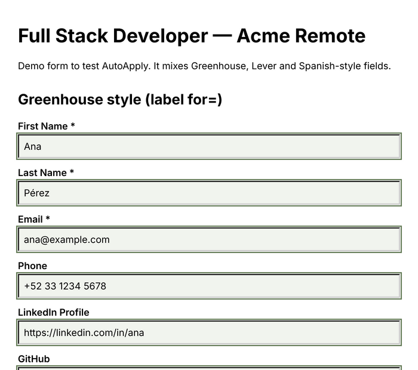
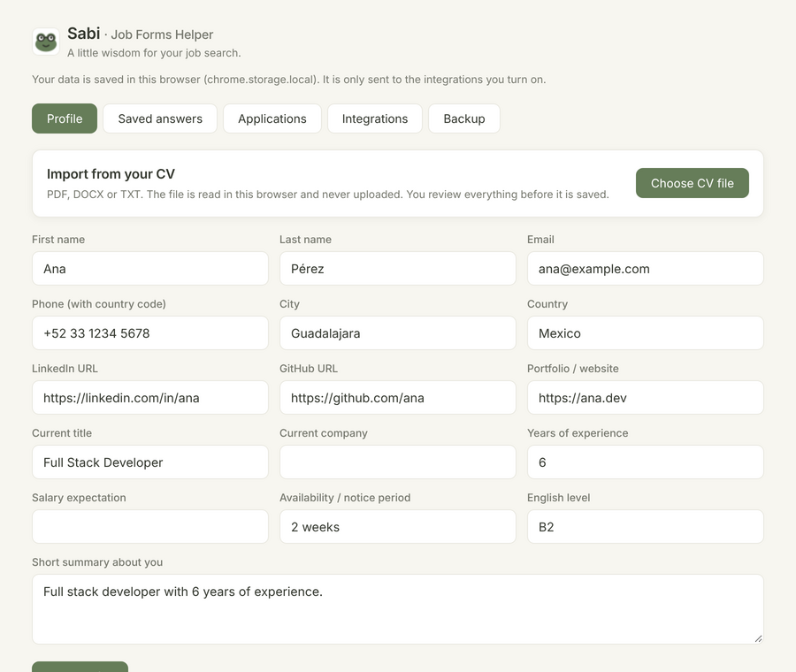

# Sabi – Job Forms Helper 🐸

**Less typing. More opportunities.**

Sabi is a Chrome extension that fills job application forms with your profile, after you review them, and helps you track every application.

I was tired of typing the same information from my CV in every job form. Sabi saves your data once and uses it on Greenhouse, Lever, Workable and custom forms, in English and Spanish.

| Filled form | Profile page |
|---|---|
|  |  |

## Features

- **Import from your CV** (PDF, DOCX or TXT): your profile is filled from your CV, in the browser, with no upload. You review every field before it is used.
- **Review & fill** in two clicks: see the list of fields, then fill name, email, phone, links, city, country, salary, English level and more.
- **Smart field detection** using `autocomplete`, input type, `<label>`, `aria-label`, placeholder, `name` and `id`. Works with labels in English and Spanish.
- **Saved answers** for open questions ("Why do you want to work here?"). The extension picks the most similar saved question (Jaccard similarity).
- **Learns from you**: save the long answers you write on a page with one click.
- **Application history** with status (applied, interview, offer, rejected, ghosted), notes and CSV export.
- **Integrations (Adapter pattern)**: save each application in Google Sheets (one row per application, you track the status there), ClickUp, an Excel file or any webhook at the same time. See [docs/integrations.md](docs/integrations.md).
- **Works with React, Vue and Angular forms**: it uses the native value setter and fires `input`, `change` and `blur` events.
- **Works inside iframes** (for example, embedded Greenhouse forms).
- **Private by design**: data lives in `chrome.storage.local`. No server, no tracking. The script only runs when you click the button (`activeTab`), and external sites (like ClickUp) are only allowed when you turn on an integration (optional permissions).

## Security

The extension was audited with a trap job page (hidden fields, third-party iframes, formula injection). All findings are fixed and covered by tests. See [SECURITY.md](SECURITY.md).

- Fills **only visible fields**, and only after you review the list in the popup.
- Never sends your data to third-party iframes (ads, widgets).
- Saved answers are never filled without your tick.
- Text that looks like a formula is neutralized before it reaches Google Sheets or CSV.

## Brand

Sabi is a wise, friendly sage-green frog. *A little wisdom for your job search.*

| Token | HEX | Usage |
|---|---|---|
| `--sabi-primary` | `#667D59` | Primary brand, buttons, active states |
| `--sabi-background` | `#F7F6F0` | Main background |
| `--sabi-surface` | `#FFFFFF` | Cards, forms, surfaces |
| `--sabi-secondary` | `#EAE9E1` | Borders, dividers |
| `--sabi-text` | `#34382F` | Headings and text |
| `--sabi-muted` | `#77796F` | Secondary text |
| `--sabi-accent` | `#B5A3C9` | Small details only |

Font: Inter (bundled, no request to Google Fonts). Tokens and dark mode: `public/styles.css`. Icon sources: `assets/`.

## Tech stack

TypeScript · Chrome Extension Manifest V3 · esbuild · Vitest + jsdom

## Project structure

```
src/
  core/        Pure logic, easy to test (no browser APIs except storage.ts)
    types.ts       Profile, SavedAnswer, Application
    normalize.ts   Text cleanup: lowercase, no accents, tokens
    rules.ts       Detection rules (EN + ES)
    matcher.ts     Field matching, answer similarity, select options, company guess
    storage.ts     Typed wrapper for chrome.storage.local
    xlsx.ts        Small .xlsx writer (no big library)
    downloads-writer.ts  Writes files with chrome.downloads
    cv-parser.ts   Finds profile data in a CV (EN/ES rules, no AI)
    cv-docx.ts     Reads text from .docx files
    sinks/         Adapter pattern: where an application is saved
      types.ts         ApplicationSink interface + settings
      local-sink.ts    chrome.storage (always on)
      clickup-sink.ts  ClickUp API adapter
      webhook-sink.ts  Generic JSON POST (Sheets, Excel Online, Zapier…)
      sheets-sink.ts   Google Sheets via Apps Script (append + update one cell)
      excel-sink.ts    .xlsx file with the whole history (Downloads folder)
      registry.ts      Factory + dispatcher
  content/     Runs in the job page
    dom.ts         Read labels, fill fields, collect answers
    content.ts     Exposes the API to the popup
  popup/       Popup UI (fill, log application, save answers)
  options/     Profile, saved answers, history, backup
public/        manifest.json, HTML and CSS
demo/          Demo form to try the extension
tests/         Unit tests + DOM tests on the demo form
```

## Getting started

```bash
npm install
npm run build      # creates dist/
npm test           # runs the tests
```

Load it in Chrome:

1. Open `chrome://extensions`.
2. Turn on **Developer mode**.
3. Click **Load unpacked** and select the `dist` folder.
4. Pin Sabi, open **Profile** and add your info.
5. Open a job form and click **Fill this form** (or press `Alt+Shift+F`).

To try it with the demo form, run `npx serve demo` (or any static server), open the page and click the extension.

## How matching works

1. Skip fields we should never touch (file, password, checkbox, hidden…).
2. Strong signals first: `type="email"`, `type="tel"` and the `autocomplete` attribute.
3. Then text signals, in this order: visible label, `aria-label`, placeholder, `name`, `id`.
   Text is normalized (`"Correo electrónico*"` → `"correo electronico"`) and checked with ordered regex rules.
4. Empty textareas get the most similar saved answer if the similarity is ≥ 0.3.
5. Fields that already have text are not changed, unless you choose "Replace".

## Roadmap

- [ ] Rules for Ashby and Workday
- [ ] Badge with the number of fields that can be filled
- [ ] Optional AI suggestions for new open questions
- [ ] `update()` for ClickUp (move the task when the status changes)
- [ ] Optional backend (Laravel API) to sync history between devices
