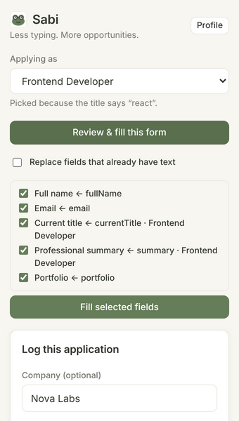
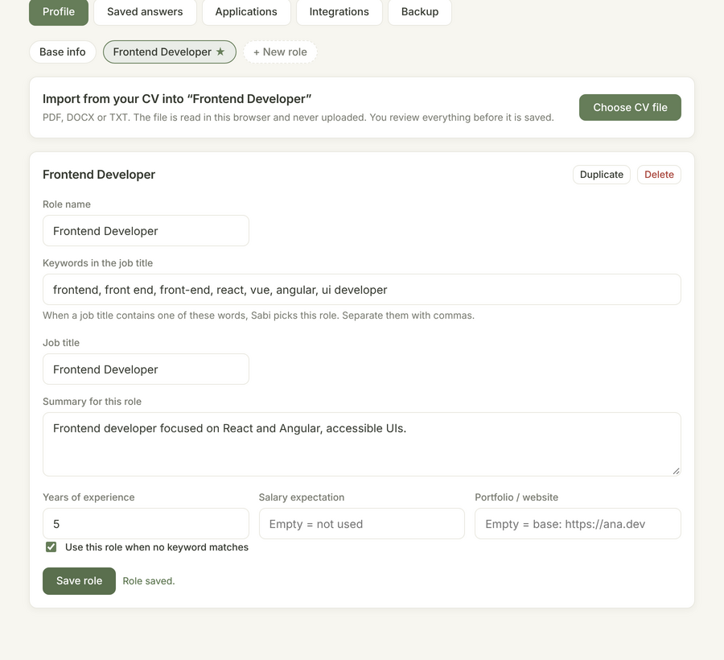

# Sabi – Job Forms Helper 🐸

**Less typing. More opportunities.**

*Personal project · 2026 · Browser extension for Chrome and Firefox*

---

## Short version (for a project card)

> **Sabi** is a browser extension that fills job application forms with my profile and tracks every application in Google Sheets. I built it because I was tired of typing the same CV information again and again.

- Review-before-fill flow, profile roles (Frontend, Data Analyst…) and CV import
- Adapter pattern to save applications in Google Sheets, ClickUp, Excel or a webhook
- Security audit with a trap job page: 11 findings, 10 fixed and 1 accepted risk documented · 114 tests

**Stack:** TypeScript · WebExtensions Manifest V3 · esbuild · Vitest · pdf.js

---

## The problem

When you look for a job, you fill the same form many times: name, email, phone, LinkedIn, years of experience, "Why do you want to work here?". Each platform (Greenhouse, Lever, Workable, custom sites) asks for it in a different way. It takes time, and it is easy to lose track of where you applied.

## The solution

Sabi saves my information once and uses it in any job form:

1. I open a job post and click Sabi.
2. Sabi picks the right **role** from the job title (for example "Senior React Developer" → *Frontend Developer*).
3. It shows a **preview** of the fields it will fill, and I confirm.
4. With one click, the application is saved in my **Google Sheet**, where I track the status.

## Main features

- **Import from CV** (PDF, DOCX, TXT): finds name, email, phone, links, title, location, English level, years of experience and summary. It runs in the browser, and nothing is uploaded.
- **Roles**: one base profile plus versions for each kind of job. Each role changes the title, summary, years, salary and portfolio. Every user creates their own roles.
- **Smart field detection** in English and Spanish, with labels, `aria-label`, `autocomplete`, placeholder and more. It works with React, Vue and Angular forms.
- **Saved answers** for open questions, suggested by similarity.
- **Integrations**: Google Sheets, ClickUp, Excel file and signed webhooks, turned on with a switch.
- **Chrome, Edge and Brave**, plus a **Firefox** build from the same code.

## Architecture highlights

**Adapter pattern for integrations.** All destinations implement one interface (`ApplicationSink`). A small dispatcher saves locally first (to avoid duplicates), then calls the external adapters in parallel. If one fails, the others still save. To add a new destination, I only write one class and add one line in the factory. The popup does not change (Open/Closed principle).

**Pure core, thin browser layer.** The matching rules, roles, CV parser and security helpers have no browser code, so they are easy to test.

**Small and private.** No server and no account. Data lives in the browser. I wrote my own small `.xlsx` writer (about 100 lines) instead of adding a big library.

## Security audit

After the first version, I audited my own extension. I built a **trap job page** with hidden fields, a third-party iframe and a page title with a spreadsheet formula.

**Before the fixes**, the page showed 2 fields but stole the phone number, the salary, a private saved answer and the GitHub profile. It could also read the ClickUp token from the content-script context.

**After the fixes**, the page got only the 2 visible fields. The main fixes:

- A real visibility check on each field and all its parents (CSS, size, position, clipping).
- Data is sent only to trusted frames (top page, same origin, known job platforms).
- A review step before filling, with saved answers unticked by default.
- The content script never reads storage.
- Formula injection is neutralized before data reaches Google Sheets or CSV.
- Signed webhooks (HMAC-SHA256), and backup files are validated before import.

The fixes are covered by regression tests, and the one accepted risk (a broad optional permission needed for custom webhooks) is documented with its limits.

## Challenges and what I learned

- **React forms ignore normal value changes.** Setting `input.value` is not enough, because React does not see the change. I used the native value setter and fired real `input`, `change` and `blur` events.
- **Choosing the right role.** Titles like "Full Stack Developer (React/Laravel)" match many roles. I chose a simple, explainable rule: the keyword that appears first in the title wins.
- **One code base, two browsers.** Firefox has no `ancestorOrigins` (before v148), no `setAccessLevel` and no `data:` downloads. I added safe fallbacks and a separate build that only changes the manifest. Mozilla's linter reports 0 errors.
- **Thinking like an attacker** changed how I design features: every input from a web page is untrusted, even the page title.

## Results

- **114 automated tests:** unit, DOM, security and Firefox fallbacks.
- **0 errors** in Mozilla's official linter (`web-ext lint`). **0 known vulnerabilities** in `npm audit`.
- Tested end to end in Chrome with real PDF and DOCX files and a trap job page. The Firefox build passes Mozilla's linter.
- Built for my own job search.

## Tech stack

TypeScript · WebExtensions Manifest V3 · esbuild · Vitest + jsdom · pdf.js · fflate · Google Apps Script · ClickUp API · web-ext

## Links

- Code: [github.com/guerrerogenesis/autoapply](https://github.com/guerrerogenesis/autoapply)
- Portfolio: [geneg.com.mx](https://geneg.com.mx)
