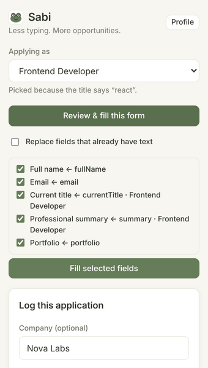

# Sabi – Job Forms Helper 🐸

**Menos escribir. Más oportunidades.**

*Proyecto personal · 2026 · Extensión de navegador para Chrome y Firefox*

---

## Versión corta (para la tarjeta del proyecto)

> **Sabi** es una extensión de navegador que llena formularios de postulación con mi perfil y registra cada postulación en Google Sheets. La creé porque estaba cansada de escribir la misma información de mi CV una y otra vez.

- Revisión antes de llenar, perfiles por rol (Frontend, Data Analyst…) e importación de CV
- Patrón Adapter para guardar postulaciones en Google Sheets, ClickUp, Excel o un webhook
- Auditoría de seguridad con una vacante trampa: 11 hallazgos, 10 corregidos y 1 riesgo aceptado y documentado · 114 tests

**Stack:** TypeScript · WebExtensions Manifest V3 · esbuild · Vitest · pdf.js

---

## El problema

Cuando buscas trabajo, llenas el mismo formulario muchas veces: nombre, email, teléfono, LinkedIn, años de experiencia, "¿Por qué quieres trabajar aquí?". Cada plataforma (Greenhouse, Lever, Workable, sitios propios) lo pide de forma distinta. Toma tiempo, y es fácil perder el control de dónde ya postulaste.

## La solución

Sabi guarda mi información una sola vez y la usa en cualquier formulario de empleo:

1. Abro una vacante y doy clic en Sabi.
2. Sabi elige el **rol** correcto según el título de la vacante (por ejemplo, "Senior React Developer" → *Frontend Developer*).
3. Muestra una **vista previa** de los campos que va a llenar, y yo confirmo.
4. Con un clic, la postulación se guarda en mi **Google Sheet**, donde le doy seguimiento al status.

## Funciones principales

- **Importar desde CV** (PDF, DOCX, TXT): encuentra nombre, email, teléfono, links, puesto, ubicación, nivel de inglés, años de experiencia y resumen. Funciona dentro del navegador y no se sube nada.
- **Roles**: un perfil base más versiones para cada tipo de puesto. Cada rol cambia el título, el resumen, los años, el salario y el portafolio. Cada usuario crea sus propios roles.
- **Detección inteligente de campos** en inglés y español, con labels, `aria-label`, `autocomplete`, placeholder y más. Funciona con formularios hechos en React, Vue y Angular.
- **Respuestas guardadas** para preguntas abiertas, sugeridas por similitud.
- **Integraciones**: Google Sheets, ClickUp, archivo de Excel y webhooks firmados, que se activan con un switch.
- **Chrome, Edge y Brave**, además de un build para **Firefox** con el mismo código.

## Decisiones de arquitectura

**Patrón Adapter para las integraciones.** Todos los destinos implementan una sola interfaz (`ApplicationSink`). Un pequeño dispatcher guarda primero en local (para evitar duplicados) y luego llama a los adapters externos en paralelo. Si uno falla, los demás sí guardan. Para agregar un destino nuevo solo escribo una clase y agrego una línea en el factory. El popup no cambia (principio Open/Closed).

**Lógica pura y una capa delgada de navegador.** Las reglas de detección, los roles, el lector de CV y las funciones de seguridad no dependen del navegador, así que son fáciles de probar.

**Ligera y privada.** Sin servidor y sin cuentas. Los datos viven en el navegador. Escribí mi propio generador de `.xlsx` (unas 100 líneas) en lugar de agregar una librería pesada.

## Auditoría de seguridad

Después de la primera versión, audité mi propia extensión. Construí una **vacante trampa** con campos ocultos, un iframe de terceros y un título de página con una fórmula de hoja de cálculo.

**Antes de las correcciones**, la página mostraba 2 campos, pero robaba el teléfono, el salario, una respuesta privada guardada y el perfil de GitHub. También podía leer el token de ClickUp desde el contexto del content script.

**Después de las correcciones**, la página solo recibió los 2 campos visibles. Las correcciones principales:

- Una revisión real de visibilidad en cada campo y en todos sus contenedores (CSS, tamaño, posición, recorte).
- Los datos solo se envían a frames de confianza (la página principal, el mismo sitio y plataformas de empleo conocidas).
- Un paso de revisión antes de llenar, con las respuestas guardadas sin marcar por defecto.
- El content script nunca lee el storage.
- La inyección de fórmulas se neutraliza antes de llegar a Google Sheets o al CSV.
- Webhooks firmados (HMAC-SHA256), y los archivos de respaldo se validan antes de importarlos.

Las correcciones tienen tests de regresión, y el único riesgo aceptado (un permiso opcional amplio que se necesita para webhooks propios) está documentado con sus límites.

## Retos y aprendizajes

- **Los formularios de React ignoran los cambios normales de valor.** No basta con asignar `input.value`, porque React no ve el cambio. Usé el setter nativo del valor y disparé eventos reales de `input`, `change` y `blur`.
- **Elegir el rol correcto.** Títulos como "Full Stack Developer (React/Laravel)" coinciden con varios roles. Elegí una regla simple y fácil de explicar: gana la palabra clave que aparece primero en el título.
- **Un solo código, dos navegadores.** Firefox no tiene `ancestorOrigins` (antes de la v148), ni `setAccessLevel`, ni descargas con URLs `data:`. Agregué alternativas seguras y un build aparte que solo cambia el manifest. El linter oficial de Mozilla reporta 0 errores.
- **Pensar como atacante** cambió mi forma de diseñar funciones: todo lo que viene de una página web es no confiable, incluso el título.

## Resultados

- **114 tests automatizados:** unitarios, de DOM, de seguridad y de compatibilidad con Firefox.
- **0 errores** en el linter oficial de Mozilla (`web-ext lint`). **0 vulnerabilidades conocidas** en `npm audit`.
- Probada de principio a fin en Chrome con archivos PDF y DOCX reales y con una vacante trampa. El build de Firefox pasa el linter de Mozilla.
- Creada para mi propia búsqueda de trabajo.

## Stack

TypeScript · WebExtensions Manifest V3 · esbuild · Vitest + jsdom · pdf.js · fflate · Google Apps Script · ClickUp API · web-ext

## Links

- Código: [github.com/guerrerogenesis/autoapply](https://github.com/guerrerogenesis/autoapply)
- Portafolio: [geneg.com.mx](https://geneg.com.mx)
